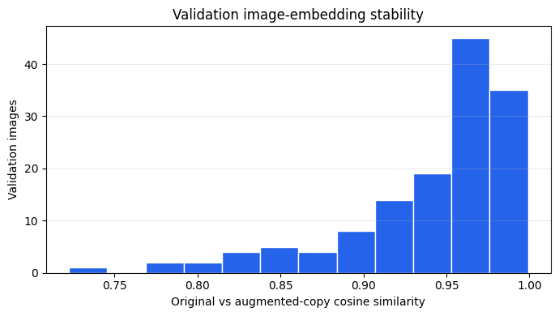
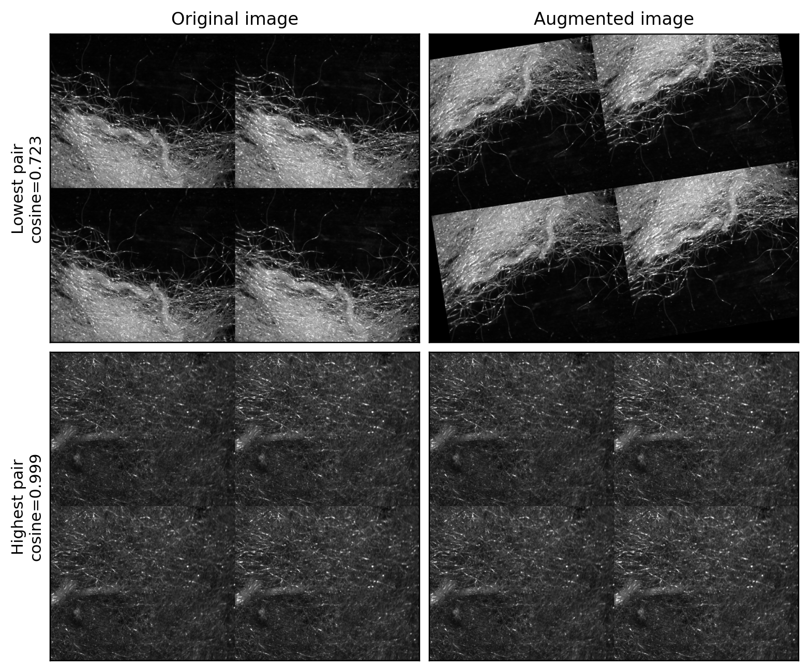
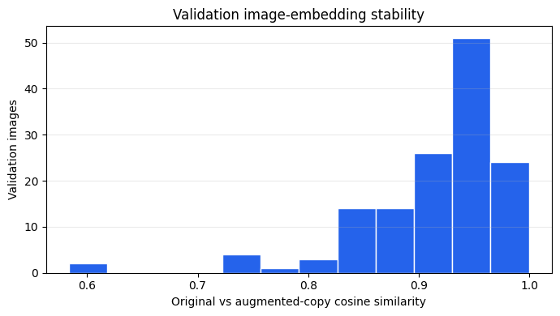
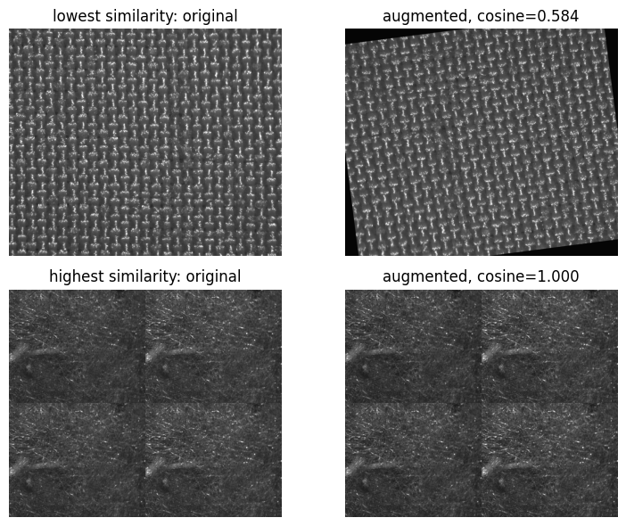

# Image-Embedding Stability

This page documents the image-embedding stability check used during development. The check compares each validation microscopy image with one augmented copy of the same image. Cosine similarity is calculated between the original image embedding and the augmented-image embedding.

The purpose of the check is to describe how each image representation responds to small image transformations. The values are interpreted within each representation, because the frozen and fine-tuned CNN embeddings use different cosine-similarity ranges.

## Evaluation of Image-Embedding Stability (previously in methodology)

Image-embedding stability is checked by comparing original microscopy images with versions augmented using the transformations defined in the image-preprocessing section. The comparison is measured with cosine similarity between the original and augmented image embeddings. The check assumes that small visual changes should not strongly change the CNN embedding, following the contrastive-learning idea that related image samples should remain close in embedding space \cite{khoslaSupervisedContrastiveLearning2021}. This is relevant for reference comparison, because the image test compares fabrics through embedding similarity. It also relates to the CRISP-ML(Q) robustness criterion, because it checks whether the image representation remains stable under small input changes \cite{studerCRISPMLQMachineLearning2021}.

## Iteration 1: Frozen DenseNet201

The first iteration uses the frozen DenseNet201 image representation. Table 1 summarises the cosine similarity between each validation image and one augmented copy of the same image.

| Images | Mean cosine similarity | Median cosine similarity | Minimum | Maximum |
|---:|---:|---:|---:|---:|
| 139 | 0.941677 | 0.960848 | 0.722550 | 0.999143 |

**Table 1.** Validation image-embedding stability for the first iteration.

**Figure 1.** Validation image-embedding stability for the first iteration.

Most augmented images remain close to their original image embeddings. A smaller number of pairs have lower cosine similarity, forming the lower tail of the distribution.

**Figure 2.** Original and augmented validation image pairs with the lowest and highest embedding similarity.

The lowest-similarity example shows a stronger visual change from the sampled augmentation than the highest-similarity example. This links the lower tail of the distribution to stronger random augmentation effects.

## Iteration 2: Fine-Tuned DenseNet201

The second iteration repeats the same check with the fine-tuned image representation. The same validation images and augmented copies are used, so the comparison shows how the changed image representation responds to the same transformations.

| Images | Mean cosine similarity | Median cosine similarity | Minimum | Maximum |
|---:|---:|---:|---:|---:|
| 139 | 0.914180 | 0.935557 | 0.583820 | 0.999546 |

**Table 2.** Validation image-embedding stability for the second iteration.

**Figure 3.** Validation image-embedding stability for the second iteration.

The fine-tuned representation has lower mean and median original-versus-augmented similarity than the frozen representation. The minimum similarity is also lower. This shows that the fine-tuned representation responds more strongly to some of the applied image transformations.

**Figure 4.** Original and augmented validation image pairs with the lowest and highest embedding similarity for the second iteration.

The lowest- and highest-similarity examples show how the same augmentation procedure can produce different embedding responses depending on the sampled transformation and the image representation.

## Interpretation

The frozen representation gives higher original-versus-augmented cosine similarities than the fine-tuned representation. This fits the wider representation-similarity results, where the frozen image embeddings also have higher cosine similarities overall.

The fine-tuned representation has lower original-versus-augmented similarity, while the pair-group similarity analysis shows clearer ordering between same-class different-fabric pairs and different-class pairs. This points to a trade-off between the two image representations: the frozen representation preserves local image similarity more strongly, while the fine-tuned representation reflects dominant class labels more clearly.